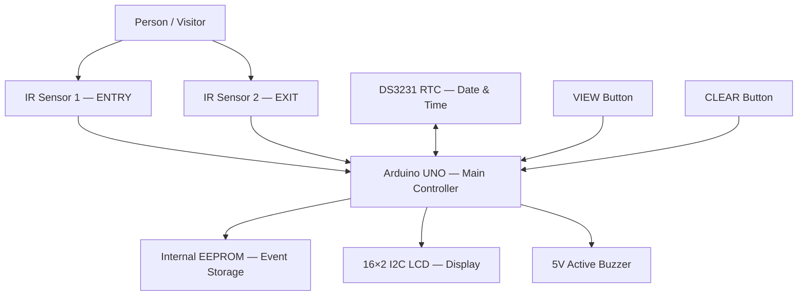

# 👥 Intelligent Visitor Monitoring and Time Tracking System

**Arduino UNO Based Smart Visitor Entry/Exit Monitoring with RTC, EEPROM and LCD**


---

## 📖 Overview

The **Intelligent Visitor Monitoring and Time Tracking System** is an Arduino-based embedded system designed to automate visitor entry and exit monitoring.

Traditional visitor registers depend on manual data entry and can be slow, inaccurate, difficult to maintain, and inconvenient for real-time occupancy monitoring.

This project provides a simple and low-cost automated solution using:

- **Arduino UNO**
- **2 IR Sensors**
- **DS3231 Real-Time Clock**
- **16×2 I²C LCD**
- **Arduino Internal EEPROM**
- **VIEW Button**
- **CLEAR Button**
- **5V Active Buzzer**

The system automatically detects visitor **ENTRY** and **EXIT**, maintains the number of people currently inside, records every valid movement with accurate date and time, stores the event in non-volatile EEPROM while record capacity is available, and allows stored records to be viewed directly on the LCD.

The stored data remains available after power loss. The system records movement timestamps and occupancy; it does not identify individuals or calculate a matched entry-to-exit duration for each person.

---

## 📸 Project Image


---

## ✨ Features

- 👤 Automatic Visitor Entry Detection
- 🚪 Automatic Visitor Exit Detection
- 🔢 Real-Time Occupancy Counting
- 🕒 Accurate Date and Time using DS3231 RTC
- 💾 Non-Volatile Event Storage using Arduino Internal EEPROM
- 📟 16×2 I²C LCD Monitoring
- 🔍 Stored Record Browsing
- 🔘 Dedicated VIEW Button
- 🧹 3-Second Long-Press CLEAR Function
- 🔊 Buzzer Indication for Valid Entry and Exit
- 🛑 Negative Visitor Count Prevention
- 🔄 Anti-Multiple-Trigger Sensor Logic
- ⚡ Power-Loss Record Recovery
- 🔋 RTC Backup using CR2032 Battery
- 📋 Timestamped Entry and Exit Records
- ♻ Continuous Automatic Operation
- ✅ No External EEPROM Module Required
- ✅ No SD Card Required
- ✅ No Internet or Cloud Connection Required

---

## 🧠 System Architecture



The Arduino UNO acts as the main controller. It continuously monitors both IR sensors, processes visitor movement, reads the current time from the RTC, stores valid events in EEPROM, updates the LCD, and controls the buzzer.

---

## ⚙️ Working Principle

The system uses two separate IR sensing paths:

```text
ENTRY Lane → IR Sensor 1 → Arduino UNO
EXIT Lane  → IR Sensor 2 → Arduino UNO
```

### Visitor Entry

When a visitor passes through the ENTRY path:

1. Validate the IR sensor detection.
2. Increase the inside count by one.
3. Read the date and time from the RTC.
4. Store the ENTRY event in EEPROM while capacity is available.
5. Show the entry notification and sound the confirmation beep.

### Visitor Exit

When a visitor passes through the EXIT path:

1. Validate the IR sensor detection.
2. Check that the inside count is greater than zero.
3. Decrease the count by one.
4. Read the RTC and store the EXIT event while capacity is available.
5. Show the exit notification and sound the confirmation beep.

If the count is already zero, ignore the additional EXIT detection.

---

## 🧰 Hardware Used

| Component | Quantity |
|---|---:|
| Arduino UNO | 1 |
| IR Obstacle Sensor Module | 2 |
| DS3231 RTC Module | 1 |
| CR2032 RTC Backup Battery | 1 |
| 16×2 LCD Display | 1 |
| I²C LCD Backpack | 1 |
| Push Button — VIEW | 1 |
| Push Button — CLEAR | 1 |
| 5V Active Buzzer | 1 |
| Breadboard | As Required |
| Jumper Wires | As Required |
| USB Type-B Cable | 1 |
| 5V Power Supply | 1 |
| Plywood Base | 1 |
| White Paper / Mounting Material | As Required |

> **Note:** The project uses the **built-in EEPROM of the Arduino UNO**. No external EEPROM module is required.

---

## 🔌 Pin Configuration

### IR Sensors

| Function | Sensor Pin | Arduino UNO |
|---|---|---|
| ENTRY Sensor | OUT | D2 |
| EXIT Sensor | OUT | D3 |
| Both Sensors | VCC | 5V |
| Both Sensors | GND | GND |

Each IR sensor is connected as:

```text
VCC → 5V
GND → GND
OUT → Assigned Arduino Digital Pin
```

The IR modules used in the prototype operate as **active-low sensors**:

```text
LOW  = Object / Visitor Detected
HIGH = No Detection
```

---

### 🔘 VIEW Button

| Button Terminal | Arduino |
|---|---|
| Terminal 1 | D5 |
| Terminal 2 | GND |

The VIEW button uses:

```cpp
INPUT_PULLUP
```

Therefore, no external pull-up resistor is required.

---

### 🧹 CLEAR Button

| Button Terminal | Arduino |
|---|---|
| Terminal 1 | D6 |
| Terminal 2 | GND |

The CLEAR button also uses:

```cpp
INPUT_PULLUP
```

A continuous press of approximately **3 seconds** clears the stored EEPROM records.

---

### 🔊 Buzzer Connection

| Buzzer | Arduino |
|---|---|
| Positive (+) | D7 |
| Negative (−) | GND |

The buzzer produces a short confirmation sound for valid ENTRY and EXIT events.

---

### 📟 LCD Connection

The 16×2 LCD uses an I²C backpack.

| LCD I²C Pin | Arduino UNO |
|---|---|
| VCC | 5V |
| GND | GND |
| SDA | A4 |
| SCL | A5 |

I²C address used:

```text
0x27
```

---

### 🕒 DS3231 RTC Connection

| DS3231 Pin | Arduino UNO |
|---|---|
| VCC | 5V |
| GND | GND |
| SDA | A4 |
| SCL | A5 |

The LCD and DS3231 share the same I²C bus:

```text
SDA → A4
SCL → A5
```

This is possible because both devices use different I²C addresses.

---

### 📌 Complete Pin Summary

| Module / Function | Arduino Pin |
|---|---|
| IR Sensor 1 — ENTRY | D2 |
| IR Sensor 2 — EXIT | D3 |
| VIEW Button | D5 |
| CLEAR Button | D6 |
| Active Buzzer | D7 |
| LCD SDA | A4 |
| LCD SCL | A5 |
| DS3231 SDA | A4 |
| DS3231 SCL | A5 |
| Module VCC | 5V |
| Module GND | GND |

---


## 💾 EEPROM Storage

The Arduino UNO's internal EEPROM is used to retain visitor movement records across power cycles.

No:

- External EEPROM
- SD Card
- Cloud Database
- Internet Connection

is required.

Each stored record uses **8 bytes**.

| Byte | Stored Information |
|---:|---|
| 0 | Event Type — ENTRY / EXIT |
| 1 | Year |
| 2 | Month |
| 3 | Day |
| 4 | Hour |
| 5 | Minute |
| 6 | Second |
| 7 | Visitors Inside After Event |

EEPROM memory layout:

```text
Address 0 → Magic Value
Address 1 → Number of Stored Records
Address 2 onward → Visitor Event Records
```

The documented layout supports **127 event records**, using 8 bytes per record and two metadata bytes. Storage is finite; power-loss retention does not provide unlimited logging.

---

## 🔋 Power-Loss Recovery

One of the key features of the system is persistent data storage.

Example:

```text
Before Power OFF

Inside Now: 3
Stored Recs: 8
```

Arduino power is disconnected.

After power is restored:

```text
Loaded records: 8
Restored Inside: 3
```

The system therefore restores:

- Visitor count
- Stored records
- Previous event history

The DS3231 continues maintaining the real-world time using its backup battery.

---

## 📟 LCD Monitoring

The 16×2 LCD provides multiple information screens.

### Home Screen

```text
Inside Now:  5
Stored Recs: 24
```

This displays:

- Current occupancy
- Total stored movement records

---

### Date and Time Screen

Press the VIEW button:

```text
Date:13/10/2026
Time:16:42:35
```

---

### Entry Detection

```text
ENTRY DETECTED
Inside:006 16:42
```

---

### Exit Detection

```text
EXIT DETECTED
Inside:005 16:45
```

---

### Invalid Exit

If the current count is zero:

```text
EXIT IGNORED
Nobody is inside
```

This prevents the visitor count from becoming negative.

---

### Stored ENTRY Record

Example:

```text
R001 ENTRY 13/10
16:20:04 Now:001
```

Meaning:

```text
Record Number = 1
Event         = ENTRY
Date          = 13/10
Time          = 16:20:04
Inside After  = 1
```

---

### Stored EXIT Record

Example:

```text
R003 EXIT 13/10
16:30:41 Now:001
```

---

### CLEAR Operation

Hold the CLEAR button:

```text
Hold 3 sec...
to clear records
```

After successful clearing:

```text
MEMORY CLEARED
Stored Recs:  0
```

Two buzzer beeps confirm the memory-clear operation.

---


## 🔘 VIEW Button Operation

Press VIEW to cycle through **live status → date and time → stored records → live status**. Each press advances one screen, allowing records to be inspected without a computer.

---

## 🧹 CLEAR Button Operation

Hold CLEAR continuously for approximately **3 seconds** to reset the stored-record count and inside count to zero. The LCD shows `MEMORY CLEARED`, and two beeps confirm the operation. The long press helps prevent accidental deletion.

---

## 🛡 Sensor Stabilization

IR sensors can occasionally produce multiple detections due to:

- Hand movement inside the sensing zone
- Object reflections
- Sensor threshold instability
- Electrical noise
- Rapid movement near the detection boundary

The software therefore uses two-stage filtering.

### Detection Validation

The sensor must remain continuously active for approximately:

```text
120 ms
```

before the detection is accepted.

### Sensor Rearming

After a valid detection, that sensor remains locked until it has remained clear for approximately:

```text
500 ms
```

This prevents one visitor from being counted multiple times.

Example:

```text
ENTRY detected | Inside: 5
ENTRY sensor ready again
```

Only after the sensor becomes ready again can another entry be counted.

---

## 🧮 Visitor Counting Logic

### ENTRY

```cpp
visitorsInside++;
```

### EXIT

```cpp
if (visitorsInside > 0) {
    visitorsInside--;
}
```

Therefore:

```text
Inside Count ≥ 0
```

at all times.

---

## 🕒 Real-Time Clock

The **DS3231 RTC** provides:

- Year
- Month
- Date
- Hour
- Minute
- Second

The RTC is used to timestamp every valid ENTRY and EXIT event.

A CR2032 backup battery allows the clock to continue running while the Arduino is powered off.

---

## 💻 Software & Technologies

- Arduino IDE
- Embedded C / C++
- Arduino UNO
- Digital Input / Output
- I²C Communication
- EEPROM Memory Management
- RTC Interfacing
- LCD Interfacing
- IR Sensor Interfacing
- Button Debouncing
- Event Logging
- Visitor Occupancy Logic
- Non-Volatile Data Storage

---

## 📚 Libraries Used

```cpp
#include <Wire.h>
#include <LiquidCrystal_I2C.h>
#include <RTClib.h>
#include <EEPROM.h>
```

### `Wire.h`

Used for the shared I²C bus connecting the Arduino UNO, LCD, and DS3231 RTC.

### `LiquidCrystal_I2C.h`

Controls the 16×2 I²C LCD.

### `RTClib.h`

Interfaces with the DS3231 real-time clock.

### `EEPROM.h`

Provides access to the Arduino UNO's built-in non-volatile EEPROM memory.

---

## 🛠 Setup and Operation

1. Connect the ENTRY IR sensor to **D2**.
2. Connect the EXIT IR sensor to **D3**.
3. Connect the VIEW button to **D5 and GND**.
4. Connect the CLEAR button to **D6 and GND**.
5. Connect the buzzer to **D7 and GND**.
6. Connect the LCD SDA/SCL to **A4/A5**.
7. Connect the DS3231 SDA/SCL to **A4/A5**.
8. Connect all VCC terminals to **5V**.
9. Connect all GND terminals to the common **GND**.
10. Install the required Arduino libraries.
11. Open the firmware in Arduino IDE.
12. Select:

```text
Board → Arduino UNO
```

13. Select the correct COM port.
14. Compile and upload the sketch.
15. Open Serial Monitor at:

```text
9600 baud
```

16. Adjust the IR sensor potentiometers for stable detection.
17. Test ENTRY and EXIT independently.
18. Verify the LCD count and stored-record values.
19. Test VIEW record browsing.
20. Test the 3-second CLEAR function.
21. Disconnect the power and reconnect to verify EEPROM recovery.

---

## 🔄 Project Workflow

1. Initialize the Arduino, LCD and RTC.
2. Load the stored records and restore the inside count.
3. Display the home screen and monitor the sensors and buttons.
4. Validate an ENTRY or EXIT detection and update occupancy; ignore EXIT when occupancy is zero.
5. Timestamp accepted events, store them while capacity is available, and update the LCD and buzzer.
6. Handle VIEW browsing and the CLEAR long press, then continue monitoring.

---

## 🧪 Experimental Results

The supplied project documentation reports the following prototype test results.

| Test | Result |
|---|---|
| LCD I²C Communication | ✅ Passed |
| DS3231 RTC Operation | ✅ Passed |
| RTC Backup During Power Loss | ✅ Passed |
| ENTRY IR Sensor Detection | ✅ Passed |
| EXIT IR Sensor Detection | ✅ Passed |
| ENTRY Count Increment | ✅ Passed |
| EXIT Count Decrement | ✅ Passed |
| Negative Count Prevention | ✅ Passed |
| Anti-Multiple-Trigger Logic | ✅ Passed |
| Buzzer Feedback | ✅ Passed |
| VIEW Button Operation | ✅ Passed |
| Date & Time Screen | ✅ Passed |
| EEPROM Record Storage | ✅ Passed |
| EEPROM Record Browsing | ✅ Passed |
| EEPROM Power-Loss Recovery | ✅ Passed |
| CLEAR Button Long Press | ✅ Passed |
| Record Reset | ✅ Passed |
| Visitor Count Restoration | ✅ Passed |
| Continuous Monitoring | ✅ Passed |
| Final Mounted Prototype | ✅ Completed |

---

## 🎯 Demonstration Scenario

Initial condition:

```text
Inside Now: 0
Stored Recs: 0
```

Three visitors enter:

```text
ENTRY 1 → Inside = 1
ENTRY 2 → Inside = 2
ENTRY 3 → Inside = 3
```

LCD:

```text
Inside Now: 3
Stored Recs: 3
```

One visitor exits:

```text
EXIT → Inside = 2
```

LCD:

```text
Inside Now: 2
Stored Recs: 4
```

VIEW button can then display:

```text
R001 ENTRY
R002 ENTRY
R003 ENTRY
R004 EXIT
```

If power is removed and restored:

```text
Loaded records: 4
Restored Inside: 2
```

---

## 🎥 Demonstration Video

[▶ Watch the full project demonstration on YouTube](https://youtu.be/QvxS8JH1_3o)

The working video demonstrates:

- Complete Hardware Prototype
- ENTRY Detection
- EXIT Detection
- Visitor Count Increment
- Visitor Count Decrement
- Buzzer Feedback
- Date and Time Display
- Stored EEPROM Records
- VIEW Button Operation
- Power-Loss Recovery
- Negative Count Prevention
- CLEAR Button Operation
- Memory Reset

---

## 🏢 Applications

- Colleges and Universities
- Libraries
- Offices
- Hospitals
- Laboratories
- Industries
- Factories
- Residential Buildings
- Exhibition Halls
- Conference Rooms
- Restricted Rooms
- Small Business Premises
- Educational Embedded-System Demonstrations

---

## ✅ Advantages

- Automatic visitor monitoring
- Real-time occupancy count
- Accurate RTC-based timestamps
- Low-cost implementation
- Simple hardware architecture
- Non-volatile local record storage
- No internet dependency
- No cloud subscription
- No SD card required
- Records retained after power loss
- Easy record browsing using LCD
- Negative-count protection
- Reliable anti-multiple-trigger detection
- Low power consumption
- Easy to maintain
- Easy to demonstrate
- Modular and expandable

---

## ⚠️ Limitations

- Prototype tracks visitor movement events rather than personal identity.
- It cannot determine which specific person corresponds to a particular exit.
- Separate ENTRY and EXIT lanes are preferred for reliable operation.
- IR sensors may be affected by reflective surfaces, alignment, or strong environmental light.
- Arduino UNO EEPROM capacity limits the number of stored records.
- The current system does not provide cloud monitoring.
- No camera-based visitor identification is implemented.
- No biometric authentication is implemented.
- No mobile application is implemented.
- The prototype is intended for educational and small-scale monitoring applications.

---

## 🚀 Future Scope

- 📷 ESP32-CAM Based Visitor Image Capture
- 👤 Face Recognition
- 🪪 RFID-Based Visitor Identification
- 📱 Mobile Application
- 🌐 Wi-Fi Remote Monitoring
- ☁ Cloud Database
- 📊 Web Dashboard
- 📈 Visitor Analytics
- 📅 Daily / Weekly Visitor Reports
- 🔔 Remote Security Alerts
- 📧 Email Notifications
- 💬 SMS / WhatsApp Alerts
- 🖥 Computer-Based Monitoring Dashboard
- 💾 SD Card Data Logging
- 🔐 Authorized Visitor Verification
- 🚨 Maximum Occupancy Alert
- 🌐 Multiple Entrance Monitoring
- 🧠 AI-Based Visitor Analysis
- 🔋 Battery Backup
- 📡 IoT Integration

---

## 📌 Important Technical Notes

### Internal EEPROM

```text
Storage = Arduino UNO Built-In EEPROM
External EEPROM = Not Required
```

### Buttons

```text
VIEW  → D5 → INPUT_PULLUP
CLEAR → D6 → INPUT_PULLUP
```

No external pull-up resistors are required.

### I²C Bus

```text
Arduino A4 → LCD SDA + RTC SDA
Arduino A5 → LCD SCL + RTC SCL
```

### Sensor Logic

```text
LOW  → Visitor Detected
HIGH → Clear
```

### Detection Filtering

```text
Detection Validation = 120 ms
Sensor Rearm Clear Time = 500 ms
```

### CLEAR Function

```text
Long Press = 3 Seconds
```

---

## 👨‍💻 Author

**Eshwar Prasad Y**

Electronics & Communication Engineering

Embedded Systems | IoT | Arduino | Microcontrollers | Automotive Electronics

---

## 🙏 Acknowledgements

Special thanks to:

- Arduino Community
- Open-Source Hardware Community
- Embedded Systems Community
- Adafruit RTClib Contributors
- LiquidCrystal_I2C Library Developers
- Electronics & Communication Engineering Community

---

## ✅ Project Status

```text
✅ Hardware Completed
✅ Arduino Firmware Completed
✅ LCD Integration Completed
✅ DS3231 RTC Integration Completed
✅ ENTRY Sensor Testing Completed
✅ EXIT Sensor Testing Completed
✅ Anti-Multiple-Trigger Logic Completed
✅ Visitor Counting Completed
✅ Buzzer Integration Completed
✅ VIEW Button Completed
✅ CLEAR Button Completed
✅ EEPROM Storage Completed
✅ Power-Loss Recovery Completed
✅ Record Browsing Completed
✅ Final Prototype Mounted
✅ Working Prototype Demonstrated
✅ Project Completed Successfully
```

---

## ⭐ Support

If you find this project useful, consider giving the repository a **Star ⭐**.

Feel free to fork the project and extend it with:

- ESP32
- IoT monitoring
- Cloud storage
- Camera-based identification
- RFID authentication
- Web dashboards
- Mobile applications
- Advanced visitor analytics

---

**Intelligent Visitor Monitoring and Time Tracking System**

**Arduino UNO | 2 IR Sensors | DS3231 RTC | Internal EEPROM | 16×2 I²C LCD | Real-Time Visitor Monitoring**
